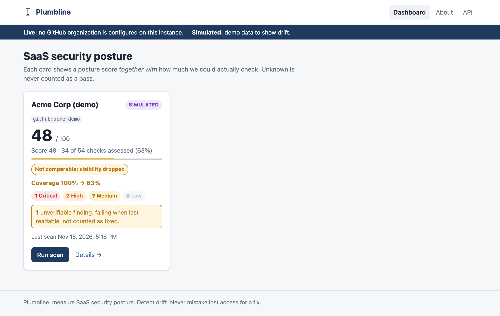
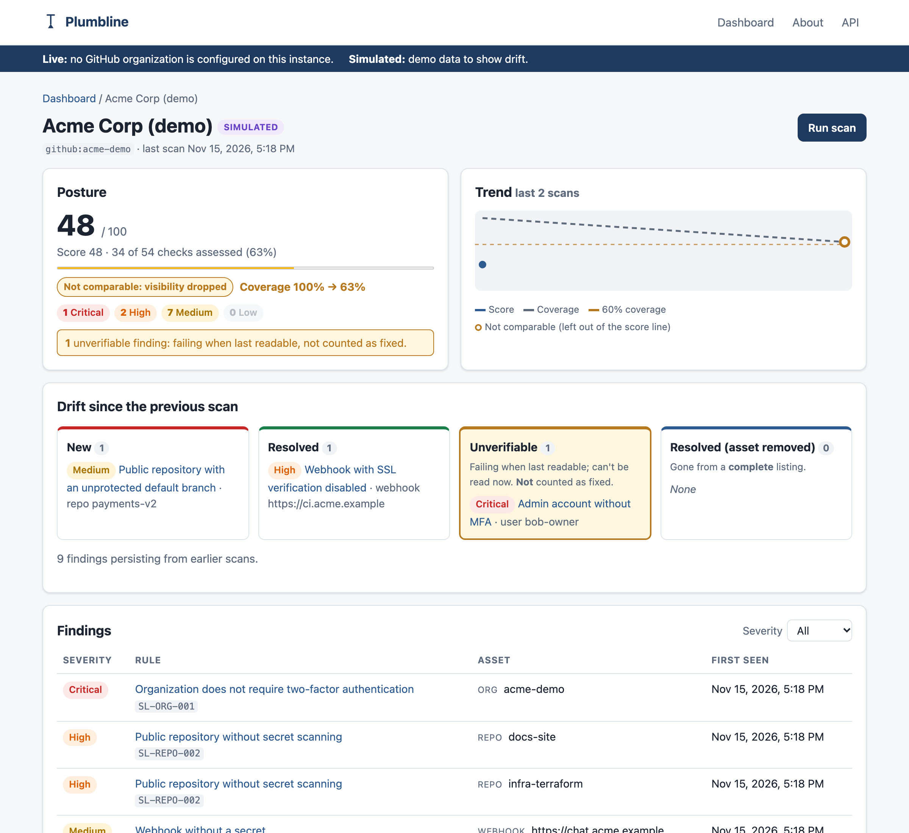

# Plumbline

**Measure SaaS security posture. Detect drift. Never mistake lost access for a fix.**

[](https://github.com/Rahul03082001/plumbline-sspm/actions/workflows/ci.yml)

Plumbline is a small SaaS Security Posture Management (SSPM) service in Go. It
connects to a GitHub organization with a **read-only** token, normalizes its
security configuration into a provider-agnostic asset model, and checks it
against posture rules. Every (rule, asset) gets **pass, fail, or unknown**. You
get a score **together with coverage**, findings with evidence and remediation,
and **drift** since the last scan: new, resolved, and *unverifiable*.

> **What's real:** one live integration (GitHub) and one **simulated** GitHub tenant
> (`github:acme-demo`) whose data changes between scans so you can watch drift.
> The simulated tenant is demo data, not a real integration.

**Live demo:** _add your Cloud Run URL here after deploying (see [docs/deploy.md](docs/deploy.md))._




## Architecture

```
 Browser (htmx) ──/ui/... (HTML)──┐   ┌──/api/... (JSON)── API clients
                                  ▼   ▼
                  web handlers: parse input, call service, render
                                    │
                 scan service: POST → 429? 409? → queued → buffered channel → 2 workers
                                    │
           connector.Collect(ctx)   │  GET only · Link pagination · rate-limit aware
             ├─ GitHub live         │  (api.github.com, fine-grained read-only PAT)
             └─ GitHub simulated    │  (fake http.RoundTripper serving GitHub-shaped JSON)
                                    ▼
           normalize → Assets {kind, external_id, attributes}  + per-kind collection status
                                    ▼
           carry forward assets missing from INCOMPLETE listings (as unknown)
                                    ▼
           YAML rules → pass | fail | unknown   (+ last_definitive history)
                                    ▼
           ONE transaction: collections + assets + results + score/coverage/status
                                    ▼
           SQLite (WAL) ──► drift vs previous succeeded scan ──► UI / API / metrics
```

## How normalization makes rules provider-agnostic

Connectors turn API responses into `Asset`s with typed, provider-neutral
attributes (`user.mfa_enabled`, `repo.default_branch_protected`,
`webhook.insecure_ssl`, …). Rules only reference those attributes, never GitHub
JSON. Adding Salesforce means a new connector and normalizer; rules that target
the same attributes carry over, and anything a provider can't report shows up as
**unknown** instead of a fake pass. Rules are validated at startup against the
attribute schema, so a typo in a rule stops the app instead of silently never firing.

## Rules

| ID | Kind | Fails when | Severity |
|---|---|---|---|
| SL-ORG-001 | org | `two_factor_required == false` | critical |
| SL-ORG-002 | org | `default_repo_permission in [write, admin]` | high |
| SL-ORG-003 | org | `members_can_create_public_repos == true` | medium |
| SL-USER-001 | user | `is_admin == true` AND `mfa_enabled == false` | critical |
| SL-REPO-001 | repo | `visibility == public` AND `default_branch_protected == false` | medium |
| SL-REPO-002 | repo | `visibility == public` AND `secret_scanning == false` | high |
| SL-HOOK-001 | webhook | `insecure_ssl == true` | high |
| SL-HOOK-002 | webhook | `has_secret == false` | medium |
| SL-HOOK-003 | webhook | `url_scheme == http` | high |

## Pass, fail, unknown, and coverage

- **Three-valued rules.** If any field a rule needs is unknown (permission denied,
  field not returned, asset not listed), the result is `unknown`, never pass or fail.
  Evidence records why, e.g. `{"reason":"permission_denied","endpoint":"GET /orgs/{org}/members?filter=2fa_disabled"}`.
- **Score** starts at 100 and loses 15 / 8 / 3 / 1 per critical / high / medium / low
  failure, over **assessed** checks only. **Coverage** = assessed ÷ applicable.
- Always shown together: **"Score 74 · 11 of 14 checks assessed (79%)"**.
  Below 60% coverage there is **no score**, only "Insufficient coverage" and the reasons.
- **Not comparable.** Excluding unknowns means a score can *rise* just because
  failing checks became unreadable. If any check went fail → unknown, or coverage
  fell more than 5 points, the scan is flagged **"Not comparable: visibility dropped"**,
  shows "Coverage 100% → 63%", never gets a green arrow, and is a gap in the trend line.

## Drift

Each result is compared with the **last definitive** state (most recent pass/fail,
looking through unknown scans) of the same fingerprint
`sha256(connection | rule | kind | external_id)`.

| Last definitive | Now | Drift |
|---|---|---|
| none / pass | fail | **new** (labelled *regressed* if it was pass) |
| fail | fail | persisting (even across unknown scans; "first seen" is kept) |
| fail | pass | **resolved** |
| fail | unknown | **unverifiable** (amber; *not* resolved; stays so while unknown) |
| fail | gone after a **complete** listing | **resolved (asset removed)** |
| any | gone after a partial/failed listing | carried forward as unknown → unverifiable if it was failing |

Three rules keep it honest: **losing access is not fixing**, **missing is not
removed**, and **unknown doesn't reset history**. Carried-forward assets also stay
in the coverage denominator, so coverage can't improve by losing sight of things.

The simulated tenant cycles **v1 → v2 → v2 → v1**: the admin-without-MFA finding
goes fail → unverifiable → unverifiable → **persisting** (not "new"), a fixed
webhook comes back as **regressed**, and a repo added in v2 is **resolved (asset removed)**.

## Least-privilege GitHub permissions

Fine-grained PAT, one org, read-only, 90-day expiry. Full table and verification
notes: [docs/permissions.md](docs/permissions.md).

| Endpoint (GET only) | Permission |
|---|---|
| `/orgs/{org}` | none listed (owner-only fields) |
| `/orgs/{org}/members` (+ `role=admin`, `filter=2fa_disabled`) | Organization › Members: Read |
| `/orgs/{org}/outside_collaborators` (+ `filter=2fa_disabled`) | Organization › Members: Read |
| `/orgs/{org}/repos` | Repository › Metadata: Read |
| `/repos/{owner}/{repo}/branches/{branch}/protection` | Repository › Administration: Read |
| `/orgs/{org}/hooks` | Organization › Webhooks: Read |

## GitHub response handling

| Response | What Plumbline does |
|---|---|
| **401** | Fail the scan (`unauthorized`). No retry. Previous results stay current. |
| **403/429 + `x-ratelimit-remaining: 0`** | Primary limit: wait until `x-ratelimit-reset` (+1s), then retry. |
| **403/429 + `retry-after`** | Secondary limit: wait exactly that long, then retry. |
| **403 body "secondary rate limit"** (or bare 429) | Wait 60s, doubling on repeats. At most 2 rate-limit retries. |
| Wait longer than the scan deadline | Fail now with `rate_limited` + retry time ("try again after 3:42 PM"). Never retry early. |
| **Other 403** | Permission problem: no retry; affected attributes become unknown; scan continues. |
| **404 "Branch not protected"** | `default_branch_protected = false` (a real answer). |
| **Other 404** | Unknown, `not_found_or_no_access`. |
| **5xx / network** | Retry 3× with backoff 0.5s, 1s, 2s + jitter. |
| Error on page 2+ of a listing | Collection is `partial`; on page 1 it's `failed`. |

## Design decisions and tradeoffs

Every decision is explained in plain language in **[DECISIONS.md](DECISIONS.md)**. Highlights:

- **Go over Python.** The workload is concurrent I/O with deadlines and cancellation
  (goroutines, `context`, `errgroup`), it ships as one static binary in a distroless
  image, and needs only 5 direct dependencies. Cost: slower to write while learning,
  wordier JSON handling (kept in one helper file).
- **SQLite + in-process queue** instead of Postgres + Cloud Tasks/Pub/Sub: right for a
  single-instance demo, zero infrastructure. The scale-out path is in "Next steps".
- **Single-instance Cloud Run** (`--max-instances=1`) because the queue and DB live in
  the instance. `max-instances` is a scaling limit, **not a lock** (old and new
  revisions can overlap during a deploy). Real coordination needs a shared database
  and a durable queue.
- **`--no-cpu-throttling`**: scans run after the HTTP response returns; with
  request-based billing Cloud Run would throttle the CPU and stall them.
- **Ephemeral demo data**: SQLite sits on the in-memory filesystem and resets when the
  instance stops; startup re-seeds the simulated tenant. Startup recovery (marking
  leftover queued/running scans failed) only matters when the DB survives a restart.
- **Atomic publish**: a scan's collections, assets, results and score are written in
  one transaction. A failed scan publishes nothing; the previous scan stays current.
- **One active scan per connection**, enforced by a partial unique index, so two
  racing clicks can't start two scans (the second gets 409 with the active scan's ID).

## Numbers

| | |
|---|---|
| Tests | **72** test functions, **146** cases incl. subtests (`go test -race ./...`), plus 2 Playwright browser tests |
| Direct Go dependencies | **5** |
| Static binary | ~16 MB (stripped) |
| Container image | **31.2 MB** uncompressed (distroless static, non-root; measured in CI) |
| Cold start / p50 scan time | _measure after deploy (commands in docs/deploy.md §10)_ |

## Run locally

```bash
make run                       # simulated tenant only, http://localhost:8080
GITHUB_TOKEN=... GITHUB_ORG=plumbline-demo-org make run   # plus the live org
make test                      # go test -race ./...
make lint                      # go vet + staticcheck
make e2e                       # Playwright browser tests (needs Node)
make docker                    # build the container image
```

Settings (env vars): `PORT` (8080), `DB_PATH` (`./plumbline.db`), `GITHUB_TOKEN`,
`GITHUB_ORG`, `SIMULATED_SCAN_DELAY` (2s), `TRUSTED_PROXY_HOPS` (0; 1 on Cloud Run),
`LOG_LEVEL` (info).

API: `GET /api/connections`, `POST /api/connections/{id}/scans` (202 / 409 / 429),
`GET /api/scans/{id}`, `/api/scans/{id}/results?result=fail&severity=high`,
`/api/scans/{id}/drift`, `/api/rules`, `/healthz`, `/readyz`, `/metrics`.

## Project layout

```
cmd/plumbline/            wiring, config, startup recovery, graceful shutdown
internal/config           env vars
internal/store            SQLite, embedded migrations, all SQL, transactions
internal/model            Asset, Rule, CheckResult, Scan, typed attribute getters
internal/connector        Connector interface
internal/connector/github live connector: client, pagination, retries, normalizer
internal/connector/simulated  fake GitHub tenant (v1/v2 fixtures) via the same connector
internal/rules            YAML rules, validator, three-valued evaluator
internal/scan             queue, workers, atomic publish, drift, score, coverage
internal/metrics          Prometheus metrics
internal/web              handlers, middleware, templates, static
testdata/github           recorded GitHub responses
e2e/                      Playwright tests
```

## Next steps (out of scope for this demo)

- **Scale to many tenants:** Postgres, Cloud Tasks / Pub/Sub for durable dispatch,
  per-tenant rate-limit budgets, partitioned results tables.
- **GitHub App installation tokens** instead of a PAT; incremental collection from
  audit logs and webhooks instead of full scans.
- More providers (Google Workspace, Slack) through new connectors and normalizers.
- More GitHub checks (Dependabot alerts, stale admins, rulesets alongside branch protection).
- User accounts, OAuth app installation, auto-remediation.
